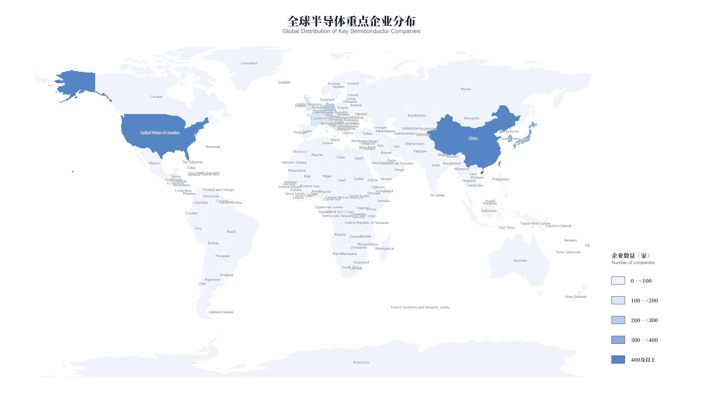
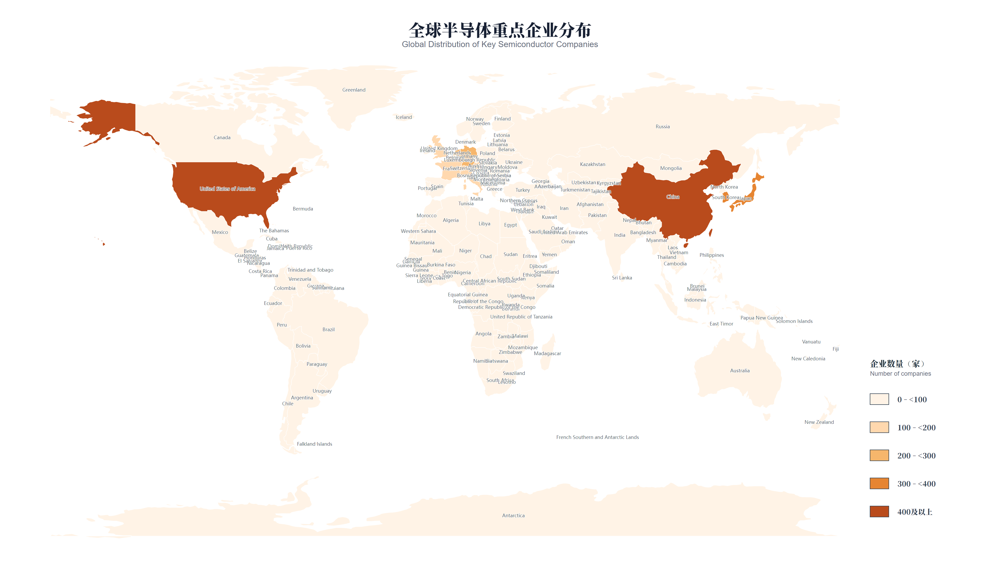
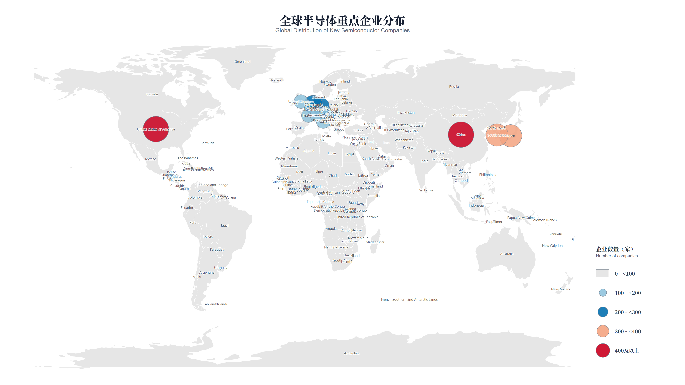

# Industry Map

[中文](README.md) | **English**

Turn **Excel metrics + GeoJSON administrative boundaries** into auditable graduated color maps and graduated bubble maps.

**Current version: V1.3.1** · Codex / Claude Code / WorkBuddy · Windows / macOS / Linux

[Download V1.3.1](https://github.com/edchwx-lang/industry-map/releases/tag/v1.3.1) · [Skill instructions](SKILL.md) · [Configuration contract](references/input-contract.md)

## Gallery

Global Distribution of Key Semiconductor Companies. These counts are **simulated for visualization only**, not actual company counts, rankings, or a complete industry census. All three maps use the same data and class thresholds.

### Blue · Graduated Color Map



### Orange · Graduated Color Map



### Red–blue–white · Graduated Bubble Map



The intervals are `[0,100)`, `[100,200)`, `[200,300)`, `[300,400)`, and `400+`. The lowest class has no bubbles and retains the gray base map; higher classes use light blue, blue, light red, and red.

## Features

- Combine either chart type with light blue, orange, or red–blue–white palettes.
- Recommended five classes; supports 3–7 automatic classes or custom thresholds, with left-closed/right-open intervals and an open-ended final class.
- Confirm chart type, palette, and classification before rendering; do not ask again for choices already supplied.
- Exact code/name joins; ambiguous matches, duplicate keys, and invalid metrics stop rendering.
- Bilingual titles and units, centered canvas titles, and 4K PNG plus vector SVG/PDF exports.
- Audit workbook, resolved configuration, and render report with classification, provenance, and hashes.
- Protected regional Excel templates; no QGIS or online basemap required.

## Installation

Requires **Node.js 22+** and a local **Chrome, Chromium, or Edge** installation. Release packages bundle JavaScript dependencies; no runtime `npm install` is needed.

1. Download `industry-map-v1.3.1.zip` from the [V1.3.1 release](https://github.com/edchwx-lang/industry-map/releases/tag/v1.3.1).
2. Extract and place the complete `industry-map` folder in the appropriate directory:

| Agent | Skill directory |
| --- | --- |
| Codex | `~/.codex/skills/industry-map` |
| Claude Code | `~/.claude/skills/industry-map` |
| WorkBuddy | `~/.workbuddy/skills/industry-map` |

`~` means your user home directory. Back up an existing version outside the skills directory to avoid duplicate discovery. Restart or refresh your agent's skill list.

From the installed `industry-map` folder:

```sh
node dist/industry-map.mjs version
```

Expect `"version":"1.3.1"`. See [compatibility notes](references/compatibility.md) for browser and path configuration. Actual exports have been tested on Windows. macOS/Linux path behavior is unit-tested, but native export acceptance on those systems remains unverified.

## Usage

Give your agent an Excel workbook and GeoJSON file, for example:

> Use industry-map to show the global distribution of key semiconductor companies. The metric is company count. Produce blue and orange graduated color maps and a red-blue-white graduated bubble map. Use five classes with lower thresholds 0, 100, 200, 300, and 400.

Or use the CLI directly:

```sh
node dist/industry-map.mjs inspect --geojson input.geojson --excel metrics.xlsx --json inspection.json
node dist/industry-map.mjs render --config map-config.json
```

See the [input/output contract](references/input-contract.md) for configuration examples. Existing outputs are protected; use `--force` only after explicit overwrite approval.

Each render creates `.png`, `.svg`, `.pdf`, `data-audit.xlsx`, `map-config.resolved.json`, and `render-report.json`.

## Development and packaging

```sh
npm ci
npm test
npm run build
npm run package-agents -- --output ../industry-map-packages
```

## V1.3.1 changes

Approved light-blue and red–blue–white palettes, unchanged orange palette, bilingual layout, hidden lowest-class bubbles without losing audit data, and explicit region aggregation with source-row provenance. The gallery includes these revisions.

## Data and usage limits

Boundary sources are recorded in the [manifest](boundary/manifest.json) and [boundary notes](references/boundary-assets.md). Preserve their non-commercial and upstream-terms notices; a public repository does not grant unrestricted commercial rights to every boundary asset. Examples are not official maps or statistical releases. Labels can overlap in dense regions. See [third-party notices](THIRD_PARTY_NOTICES.md) for software licensing information.
